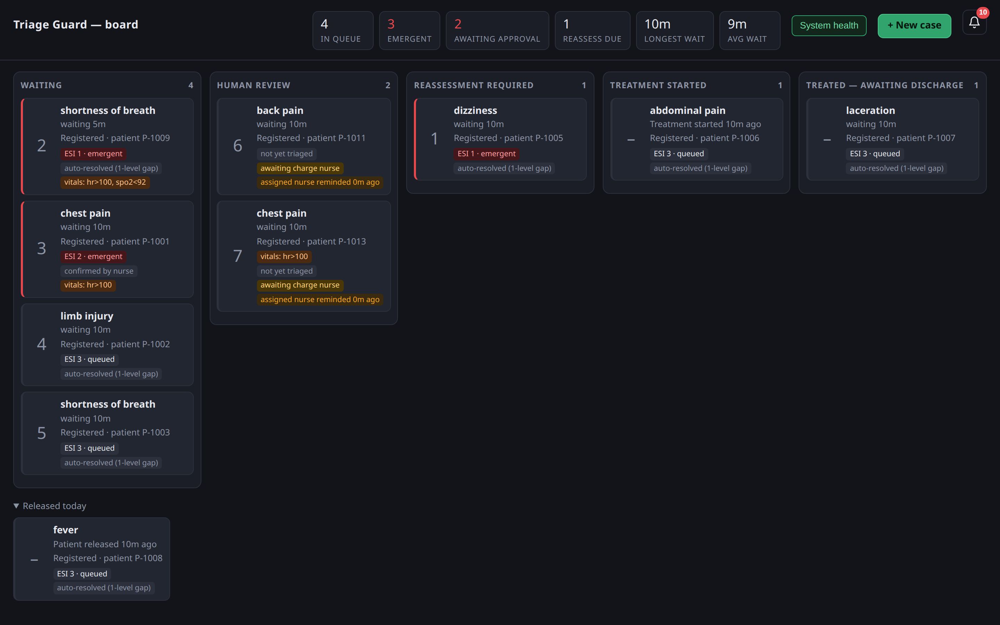
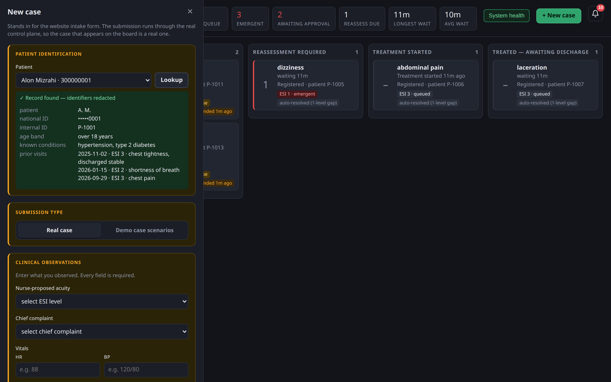
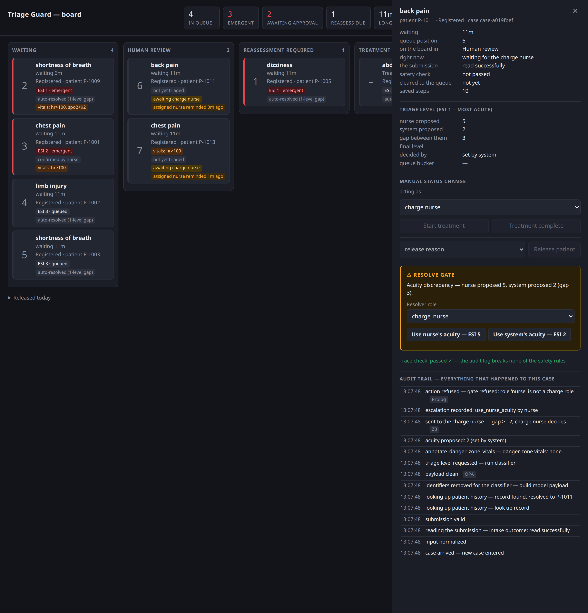
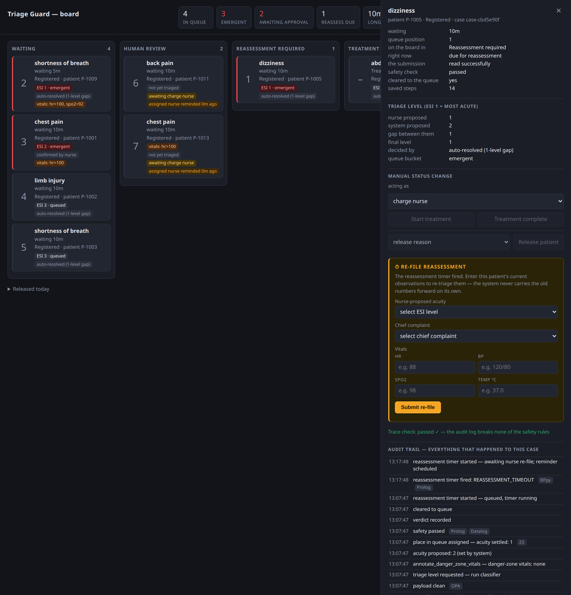
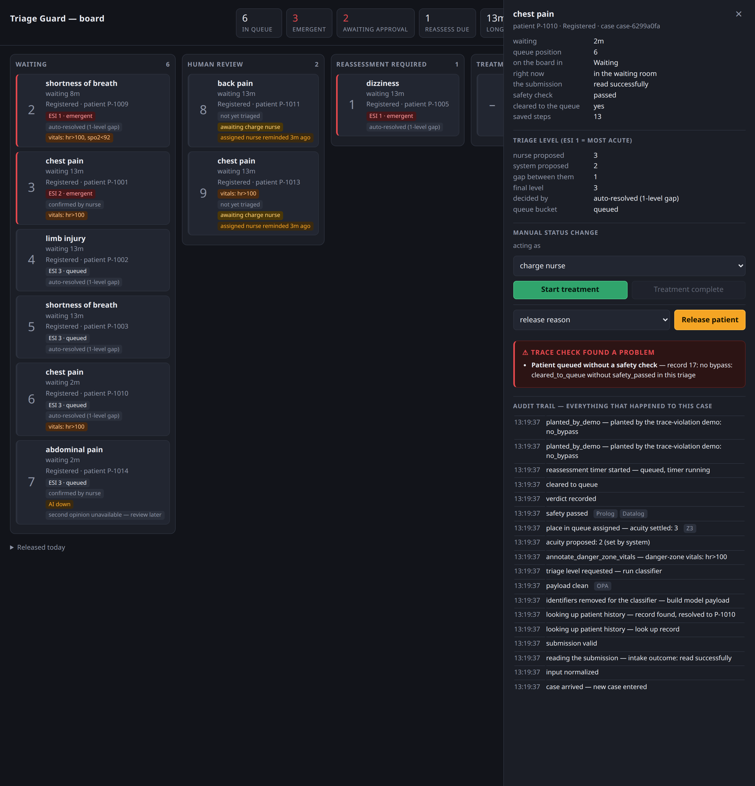
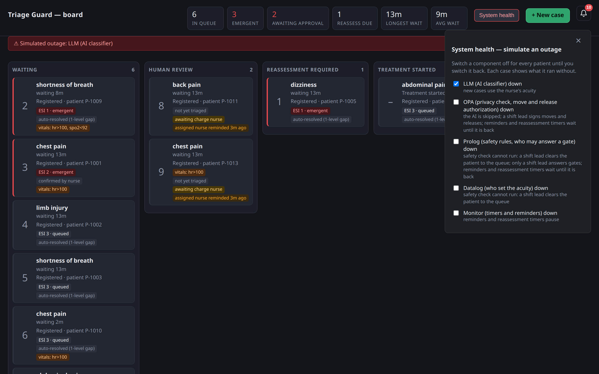
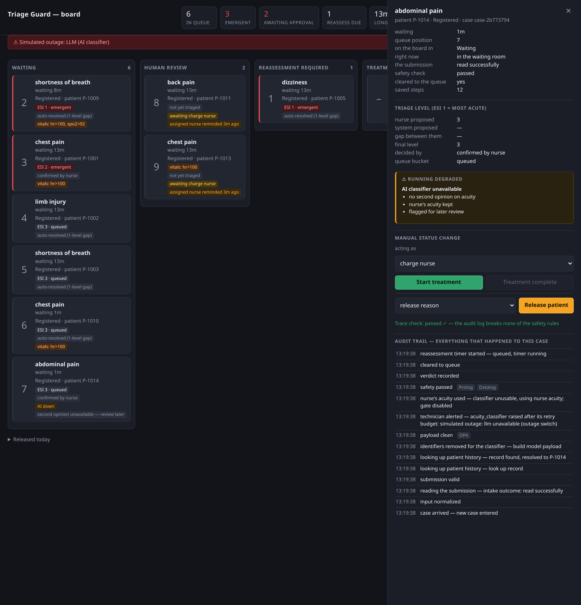

# Triage Guard

Under-triage in hospital waiting rooms gets caught too late, and patients deteriorate
without being reassessed. Triage Guard helps staff identify how far a patient has
deteriorated, which improves ER capacity logistics and treatment.



**Docs:**

- [Architecture and State-Machine Specification](docs/SPECIFICATION.md)
- [System Modeling](docs/SYSTEM_MODELING.md)

### Run all services at once

In VS Code, open the Run and Debug panel and pick a compound from
`.vscode/launch.json`:

- **All services (crm-stub + board + sweeper)** — both APIs plus
  the waiting-room monitor, debuggable.

Stopping the compound stops every service in it. Open `http://127.0.0.1:8002` for
the one nurse-facing page — the queue board and the intake front door together.
For running each service on its own, or the offline CLI/test loop, see below.

### Run all tests

Each service is its own uv project with its own virtualenv, so each suite runs
from inside its folder — `uv run pytest` at the repo root falls back to the system
Python and fails on missing imports. From the repo root, with the shared Postgres up:

```bash
for d in triage-app board crm-stub; do (cd "$d" && uv run pytest) || break; done
```

It stops at the first failing suite.

## The Triage guard app

A **LangGraph** skeleton: the Transitions table from `docs/SPECIFICATION.md`
transcribed into a `StateGraph`, so the set of allowed moves is declared data the
framework validates and can draw. Skeleton only — the actors return canned output
and the symbolic engines are stubs — but nothing is faked away to make it run: the
human gate really suspends the case to a checkpoint, retry budgets really count,
and an unauthorized action is really refused (`BLK`) without moving the case.

Eleven of the twelve actors are deterministic code, humans, or data stores. The
one generative step, the Acuity Classifier, is mocked by default and needs no key.

### Run

```bash
cd langfuse && docker compose up -d && cd ..   # Langfuse stack, if not already up
docker compose -f db/docker-compose.yml up -d  # shared Postgres — checkpoints + timers
cp triage-app/.env.example triage-app/.env      # optional — mock mode needs nothing in it
cd triage-app
uv sync
uv run triage-guard            # clean / missing / failed
uv run pytest                  # offline, no LLM key needed
uv run sweeper                 # waiting-room monitor — fires reassessment timers
```

Each run prints the final state and the full audit trail, labelled with
transition names from the Transitions table (the spec maps each to its
diagram number). With Langfuse configured it also sends one trace per
run, with a span per node.

It ends with `trace_safety`: an independent re-read of the audit log that reports any
case which reached the queue or treatment without passing safety and any required
human approval, continued after a safety failure without a correction, looped past
the correction limit without a senior, started treatment twice, changed after it was
closed, or wrote a malformed audit record.

`sweeper` is its own long-running process, separate from any single `triage-guard`
run — without it, a case that reaches `monitoring` schedules a reassessment timer
but nothing ever fires it, so it never moves to `reassessment_required`. See
[triage-app/app/monitor/README.md](triage-app/app/monitor/README.md) for how it
works.

To drive it from a browser instead — including pausing at the acuity gate and
resolving it as a charge nurse — run `board/`. Its new-case panel is the intake
form. Once a case's reassessment timer fires, it pauses again waiting for a
nurse to re-file it with fresh observations; the board surfaces that pause as a
form on the case's detail panel, answered through its own `POST
/api/case/{case_id}/reassess`.

See [triage-app/README.md](triage-app/README.md) for the full details, and
[docs/plans/2026-09-10-langgraph-migration-design.md](docs/plans/2026-09-10-langgraph-migration-design.md)
for why this is LangGraph and not CrewAI.

## The CRM stub

A local stand-in for the patient-history CRM the crew reads from: 20 mock
patients in the shared Postgres's `crm` database, behind the exact contract in
the spec, wrapped in FastAPI. Not a real external system — but because the
contract matches, a real CRM can replace it without touching the rest of the
architecture.

```
crm-stub/
├── crm/
│   ├── models.py       # PatientRecord, FetchResult/PatchResult, status enums
│   ├── repository.py   # Postgres implementation of the three operations
│   ├── seed.py         # 20 varied mock patients
│   └── api.py          # FastAPI wrapper + `uv run crm` entrypoint
├── tests/
├── pyproject.toml      # its own uv project, separate from the app
└── docker-compose.yml  # run the crm from docker
```

| Operation                       | Endpoint               | Returns                                        |
| ------------------------------- | ---------------------- | ---------------------------------------------- |
| `fetch_patient_data(id)`        | `GET /patients/{id}`   | `200` found / `404` not_found / `503` db_error |
| `patch_patient_data(id, visit)` | `PATCH /patients/{id}` | `200` ok / `503` db_error                      |
| `is_available()`                | `GET /health`          | `{"available": true\|false}`                   |

`db_error` is the only outcome that trips the CRM fail-open path; `not_found` is
a normal empty (new patient), not a failure. `POST /admin/simulate-down?enabled=true`
forces `db_error` at runtime, so the degrade path can be demoed without a real outage.

### Run

```bash
docker compose -f db/docker-compose.yml up -d postgres   # the shared Postgres
cd crm-stub
uv sync
uv run crm        # seeds the `crm` database on first run, then serves on :8000
```

Or in a container, same entry point: `cd crm-stub && docker compose up`.
Interactive API docs at [http://localhost:8000/docs](http://localhost:8000/docs).

See [crm-stub/README.md](crm-stub/README.md) for the full details.

## The board

The one nurse-facing service: intake in, cases out, on one page. A kanban of
the World plane — one card per live case, one column per `clinical_status`,
sorted by the `order_key` the control plane already assigned — plus a new-case
panel that creates cases directly. Click a card for its acuity block and its
transition trail.

It computes no triage and re-computes no ordering — every write, including
case creation, re-enters the case's own paused LangGraph run rather than
writing case state directly. It never calls the CRM from its own read path, so
a CRM outage cannot blank it; the CRM stub is only reached by the intake
panel's lookup step.

```bash
cd board
uv sync
uv run board   # serves on :8002 — the queue board and the intake front door
```

See [board/README.md](board/README.md) for the full details, and
[2026-09-11-board-service-design.md](2026-09-11-board-service-design.md) for the
design it builds (milestones M0 + M1).

## Screenshots

Every screen below comes from the running board, with mock CRM patients and the
mock classifier, which always proposes ESI 2. ESI is the Emergency Severity
Index: 1 is the most urgent level and 5 the least.

### New case

The nurse picks a registered patient and looks them up. The CRM history comes
back with identifiers already masked: initials, the last four digits of the
national ID, and an age band instead of a birth date.



### Human approval gate

The nurse proposed ESI 5 and the classifier proposed ESI 2. A gap of two or more
levels pauses the case for a charge nurse. Here a plain nurse tried to answer
anyway: the Prolog authorization rule refused, the refusal is in the audit trail,
and the case stayed at the gate.



### Reassessment

This ESI 1 patient's 10-minute reassessment timer fired. The case now waits for a
nurse to enter current observations, because the system never carries the old
numbers forward on its own.



### Trace check

The trace-violation demo writes fake records straight into a case's audit log,
bypassing every guard. The independent trace check re-reads the log and reports
that the patient was queued without a safety check.



### Outage switch

With `DEMO_OUTAGES=1`, the System health panel switches a component off for every
patient until it is switched back. Here the LLM is down, and a red strip under the
header names it.



A case submitted during the outage still reaches the queue. It keeps the nurse's
acuity, and its Running degraded box lists what it went without.


